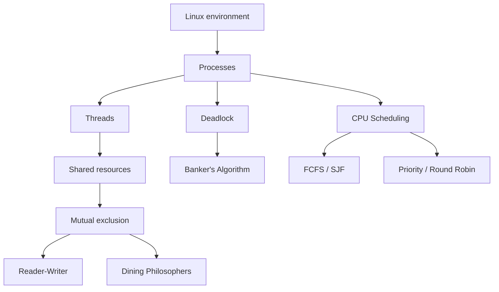

# Operating Systems Lab Index

## Master Table of Contents

| Lab | Topic | Main idea |
|---|---|---|
| 1 | [Linux Basics](01_lab1_linux_basics.md) | Navigate and operate a Linux environment |
| 2 | [Process Creation](02_lab2_process_creation.md) | Create and synchronize processes with `fork()` and `wait()` |
| 3 | [Multithreading](03_lab3_multithreading.md) | Run multiple execution paths within one process |
| 4 | [Mutual Exclusion](04_lab4_mutual_exclusion.md) | Prevent races using semaphores and monitors |
| 5 | [Reader-Writer](05_lab5_reader_writer.md) | Coordinate shared readers and writers |
| 6 | [Dining Philosophers](06_lab6_dining_philosophers.md) | Understand deadlock, starvation, and synchronization |
| 7 | [Banker's Algorithm](07_lab7_bankers_algorithm.md) | Avoid unsafe resource allocations |
| 8 | [FCFS and SJF](08_lab8_fcfs_sjf.md) | Schedule CPU work using arrival/burst information |
| 9 | [Priority and Round Robin](09_lab9_priority_rr.md) | Priority-based and time-sliced scheduling |

## Conceptual Dependency Map

## Suggested Study Order

The order above moves from OS execution basics → process/thread concurrency → synchronization → deadlock → scheduling.

### Where should I start?

- **New to Linux/C system programming?** Start with Lab 1.
- **Need `fork()` and process questions?** Study Lab 2.
- **Need concurrency programs?** Study Labs 3–6 in order.
- **Need deadlock avoidance?** Study Lab 7 after Labs 4–6.
- **Need scheduling numericals?** Study Labs 8–9.

## High-priority concepts

🔴 Process vs thread, `fork()`, parent/child relationship, `wait()`, race condition, critical section, semaphore, monitor, reader-writer synchronization, deadlock conditions, safe state, Need matrix, scheduling metrics.

🟡 Linux permissions and process commands, thread attributes, fairness variants, scheduling variants.

🟢 Extra command flags and implementation-specific details unless required by your course.
