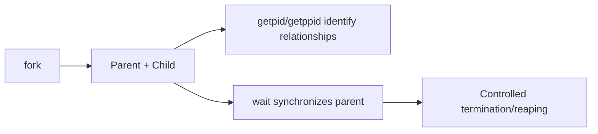

# Lab 2 — Process Creation with `fork()`, `getpid()`, `getppid()`, and `wait()`

**Priority: 🔴 High**

## 🎯 Core Idea

A process is a running program with its own process context. In POSIX systems, `fork()` creates a new process by duplicating the calling process's execution context, after which parent and child continue independently. `getpid()` identifies the current process, `getppid()` identifies its parent, and `wait()` lets a parent synchronize with a child.

## 🧠 Understand It

### `fork()` is the key idea

Before:

```text
One process
    P
```

After a successful `fork()`:

```text
        P
       / \
      P   C
 parent child
```

Both processes continue from the point after `fork()`, but the return value lets the program distinguish them.

Typical return interpretation:

| `fork()` result | Meaning |
|---|---|
| `< 0` | Creation failed |
| `0` | This is the child |
| `> 0` | This is the parent; value is child's PID |

### `getpid()` and `getppid()`

```c
pid_t pid = getpid();
pid_t parent = getppid();
```

The child can therefore identify itself and its parent.

### `wait()`

A parent can wait for a child:

```c
wait(NULL);
```

Conceptually:

```text
Parent
  |
  | wait()
  v
blocked while child runs
  |
  v
child terminates
  |
  v
parent continues
```

This provides synchronization and allows the parent to collect child termination status.

## 💡 Example Program

```c
#include <stdio.h>
#include <unistd.h>
#include <sys/types.h>
#include <sys/wait.h>

int main(void) {
    pid_t pid = fork();

    if (pid < 0) {
        perror("fork");
        return 1;
    }

    if (pid == 0) {
        printf("Child: PID=%d, PPID=%d\n",
               (int)getpid(), (int)getppid());
    } else {
        printf("Parent: PID=%d, child PID=%d\n",
               (int)getpid(), (int)pid);
        wait(NULL);
        printf("Parent: child has terminated.\n");
    }

    return 0;
}
```

Compile:

```bash
gcc process.c -o process
./process
```

The exact ordering of printed lines can vary when synchronization is absent. Here the parent waits before printing its final message.

## 🔗 Connections



This lab is a prerequisite for understanding threads and later concurrency problems.

## 📐 Key Logic

Let the return value of `fork()` be $r$:

$$
r =
\begin{cases}
<0 & \text{creation failed}\\
0 & \text{executing in child}\\
>0 & \text{executing in parent}
\end{cases}
$$

The important point is not memorizing the numbers alone; it is understanding that the same source location is reached by two processes after a successful fork.

## 📊 Process vs Thread

| Feature | Process | Thread |
|---|---|---|
| Address space | Separate from other processes | Shared within process |
| Creation | `fork()` in this lab | `pthread_create()` in Lab 3 |
| Communication | Requires process IPC mechanisms for general sharing | Shared memory is naturally available |
| Failure/isolation | Generally more isolated | Threads can directly affect shared process state |

## ⚠️ Common Confusions / Traps

- `fork()` does not return the same value in both processes.
- A child is not created only if the parent branch executes.
- Parent and child have separate process identities.
- Output order should not be assumed unless synchronization establishes it.
- `getppid()` returns the parent PID; it is not the same as the current PID.
- `wait()` is a parent-side synchronization mechanism for child termination.

## 📝 What to Remember

### 🔴 Must Understand
- What `fork()` creates.
- Why its return value differs in parent and child.
- Why `wait()` matters.
- PID vs PPID.

### 🟡 Must Remember
- Required headers and basic syntax.
- Error handling for `fork()`.

### 🟢 Nice to Know
- More advanced process-control and signal APIs.

## ✅ Quick Check

1. Why does one call to `fork()` lead to two execution paths?
2. What does `fork()` return in the child?
3. What does the positive `fork()` return value represent in the parent?
4. Why can output order vary?
5. What problem does `wait()` solve?
6. What is the difference between PID and PPID?
