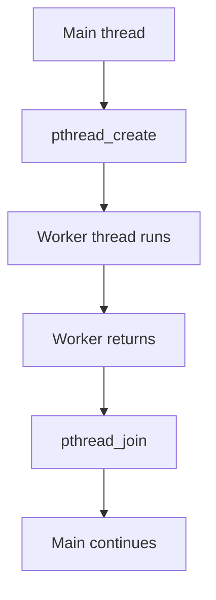

# Lab 3 — Multithreading

**Priority: 🔴 High**

## 🎯 Core Idea

A thread is an execution path within a process. Multiple threads in the same process share process resources such as the address space, which makes communication efficient but also creates the possibility of data races when shared state is modified concurrently.

## 🧠 Understand It

A process can contain:

```text
Process
├── Thread 1
├── Thread 2
└── Thread 3
```

Threads have their own execution state, while threads belonging to one process share much of the process's memory/resources.

### Creating a POSIX thread

A typical POSIX thread program uses:

```c
pthread_create()
pthread_join()
```

`pthread_create()` starts a new thread. `pthread_join()` allows one thread to wait for another thread to finish.

### Basic lifecycle



## 💡 Example

```c
#include <stdio.h>
#include <pthread.h>

void *worker(void *arg) {
    printf("Worker thread is running.\n");
    return NULL;
}

int main(void) {
    pthread_t tid;

    if (pthread_create(&tid, NULL, worker, NULL) != 0) {
        return 1;
    }

    pthread_join(tid, NULL);
    printf("Main thread continues after worker finishes.\n");

    return 0;
}
```

Compile:

```bash
gcc thread.c -o thread -pthread
```

## 🧠 Why synchronization becomes necessary

Suppose two threads execute:

```c
counter++;
```

Conceptually this can involve:

```text
read counter
    ↓
add 1
    ↓
write counter
```

If two threads interleave these operations, both may read the same old value. The final result can then be smaller than the expected number of increments.

This is the motivation for Lab 4.

## 🔗 Connections

```text
Process
  ↓
Threads share memory
  ↓
Shared variables become accessible concurrently
  ↓
Race conditions become possible
  ↓
Synchronization is required
  ↓
Semaphore / monitor
```

## 📊 Process vs Thread

| Property | Process | Thread |
|---|---|---|
| Execution unit | Program instance | Execution path |
| Memory | Separate address space | Shared process address space |
| Typical creation API here | `fork()` | `pthread_create()` |
| Synchronization need | Often IPC/synchronization | Shared data requires synchronization |

## ⚠️ Common Confusions / Traps

- Thread creation does not automatically make execution deterministic.
- Shared memory is convenient but creates synchronization responsibilities.
- `pthread_join()` waits for a thread; it is not a mutual-exclusion mechanism.
- A program that works once may still contain a race condition.

## 📝 What to Remember

### 🔴 Must Understand
- Process vs thread.
- Shared memory and race conditions.
- `pthread_create()` and `pthread_join()` roles.

### 🟡 Must Remember
- Basic thread function signature.
- Compile with the appropriate pthread option.

### 🟢 Nice to Know
- Advanced thread attributes and scheduling APIs.

## ✅ Quick Check

1. Why can threads communicate through ordinary shared variables?
2. Why does that same feature create race conditions?
3. What does `pthread_join()` accomplish?
4. Why can the output order of multiple threads vary?
5. What kind of problem does Lab 4 solve?
