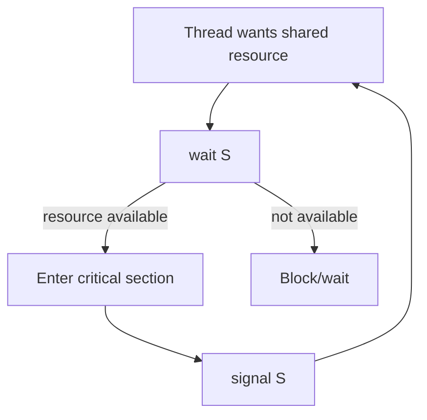

# Lab 4 — Mutual Exclusion Using Semaphore and Monitor

**Priority: 🔴 High**

## 🎯 Core Idea

Mutual exclusion means that at most one concurrent execution path enters a critical section at a time. A **semaphore** provides synchronization through operations such as wait and signal, while a **monitor** organizes shared data and synchronization around a protected abstraction.

## 🧠 Understand It

### Critical section

A critical section is code that accesses shared state and must not be executed concurrently by conflicting threads.

```text
Entry
  ↓
[ Critical Section ]
  ↓
Exit
```

The goal is:

$$
\text{At most one thread in the critical section}
$$

### Semaphore

A semaphore can be viewed as a synchronization variable accessed through atomic operations.

Common notation:

```text
wait(S)
signal(S)
```

For a binary semaphore initialized to 1:

```text
S = 1
```

A thread performs:

```text
wait(S)
critical section
signal(S)
```

Conceptually:



### Monitor

A monitor packages shared data, operations, and synchronization together. The conceptual benefit is that mutual exclusion is associated with entering monitor operations rather than being manually placed around every shared access.

> **Additional context:** In C/POSIX, monitors are not a single standard primitive named `monitor`; they are commonly constructed using mutexes and condition variables. Other languages may provide monitors directly.

## 💡 Semaphore Example

```c
#include <stdio.h>
#include <pthread.h>
#include <semaphore.h>

int counter = 0;
sem_t lock;

void *worker(void *arg) {
    for (int i = 0; i < 100000; i++) {
        sem_wait(&lock);
        counter++;
        sem_post(&lock);
    }
    return NULL;
}

int main(void) {
    pthread_t t1, t2;

    sem_init(&lock, 0, 1);

    pthread_create(&t1, NULL, worker, NULL);
    pthread_create(&t2, NULL, worker, NULL);

    pthread_join(t1, NULL);
    pthread_join(t2, NULL);

    printf("counter = %d\n", counter);

    sem_destroy(&lock);
    return 0;
}
```

The important pattern is:

```text
wait → critical section → signal
```

## 🔗 Connections

```text
Multithreading
    ↓
Shared data
    ↓
Race condition
    ↓
Critical section
    ↓
Mutual exclusion
    ├── Semaphore
    └── Monitor-style abstraction
```

## 📊 Comparison

| Feature | Semaphore | Monitor |
|---|---|---|
| Main idea | Synchronization primitive | Higher-level protected abstraction |
| Mutual exclusion | Can provide it with binary semaphore | Associated with monitor entry |
| Typical operations | wait/signal | Enter monitor operation; condition synchronization where supported |
| Risk | Incorrect pairing/order can cause bugs | Encapsulation can make synchronization easier to structure |

## ⚠️ Common Confusions / Traps

- A semaphore is not simply a variable that threads can update without synchronization.
- Forgetting `signal()` can leave other threads blocked.
- Putting only part of a critical operation under protection may still leave a race.
- Mutual exclusion prevents simultaneous critical-section access; it does not automatically solve every deadlock or starvation problem.

## 📝 What to Remember

### 🔴 Must Understand
- Critical section.
- Mutual exclusion.
- `wait`/`signal` pattern.
- Why shared updates need protection.

### 🟡 Must Remember
- Binary semaphore initialization concept.
- Monitor as a higher-level synchronization abstraction.

### 🟢 Nice to Know
- Implementation-specific monitor libraries.

## ✅ Quick Check

1. What makes a section of code a critical section?
2. Why does `counter++` need protection in the example?
3. What happens if a thread executes `wait()` and never signals?
4. How is a monitor conceptually different from a raw semaphore?
5. Does mutual exclusion by itself guarantee fairness?
