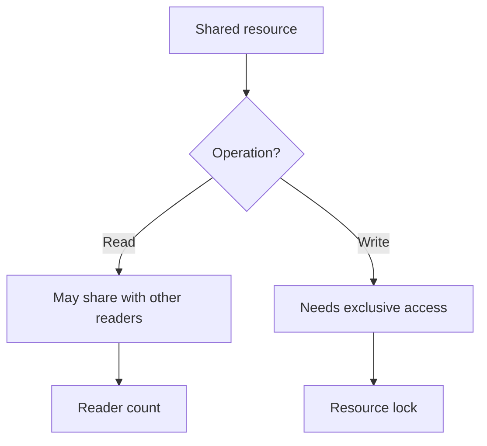

# Lab 5 — Reader-Writer Problem

**Priority: 🔴 High**

## 🎯 Core Idea

The Reader-Writer problem models a shared resource that can be read concurrently but should not be written while another reader or writer is using it. The central challenge is allowing safe parallel reads without allowing conflicting access.

## 🧠 Understand It

There are two classes of operations:

- **Reader:** observes shared data.
- **Writer:** modifies shared data.

The basic compatibility rule is:

```text
Reader + Reader  → allowed
Reader + Writer  → not allowed
Writer + Reader  → not allowed
Writer + Writer  → not allowed
```

This creates the key design tension:

> Maximize permitted concurrent reading while preserving exclusive writing.

### Reader-count pattern

A common semaphore-based design maintains a count of active readers.

Conceptually:

```text
First reader
    ↓
lock resource

Additional readers
    ↓
can enter

Last reader leaves
    ↓
unlock resource
```

The reader count itself must also be protected.

## 💡 Typical Structure

```c
sem_wait(&mutex);
read_count++;

if (read_count == 1)
    sem_wait(&resource);

sem_post(&mutex);

/* read shared resource */

sem_wait(&mutex);
read_count--;

if (read_count == 0)
    sem_post(&resource);

sem_post(&mutex);
```

A writer typically does:

```c
sem_wait(&resource);

/* write shared resource */

sem_post(&resource);
```

The exact policy determines whether readers or writers receive preference.

## 🔗 Connections



## 📊 Comparison

| Situation | Safe? | Reason |
|---|---|---|
| Multiple readers | Yes | They do not modify the resource |
| One writer alone | Yes | Exclusive modification |
| Reader + writer | No | Reader could observe inconsistent state |
| Multiple writers | No | Conflicting modifications |

## ⚠️ Common Confusions / Traps

- Protecting the resource alone is not enough if the reader counter itself is concurrently modified.
- The first-reader/last-reader idea is easy to invert.
- A correct mutual-exclusion solution can still suffer from starvation depending on policy.
- "Reader preference" and "writer preference" are different synchronization policies.

## 📝 What to Remember

### 🔴 Must Understand
- Why readers can coexist.
- Why writers require exclusivity.
- Why the reader count needs synchronization.

### 🟡 Must Remember
- First reader acquires the resource lock.
- Last reader releases it in the common reader-preference pattern.

### 🟢 Nice to Know
- Alternative fairness policies and starvation-prevention strategies.

## ✅ Quick Check

1. Why can two readers execute simultaneously?
2. Why must a writer exclude both readers and other writers?
3. What does the first reader do?
4. What does the last reader do?
5. Where can starvation occur?
