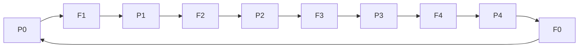

# Lab 6 — Dining Philosopher Problem

**Priority: 🔴 High**

## 🎯 Core Idea

The Dining Philosopher problem models several concurrent processes competing for limited resources. Each philosopher needs two neighboring forks to eat, making it a classic example of how resource acquisition can create deadlock and starvation.

## 🧠 Understand It

Model:

```text
       P0
   F4      F0
 P4          P1
   F3      F1
       P2
        F2
```

For each philosopher:

```text
think → acquire left fork → acquire right fork → eat → release forks
```

The dangerous strategy is for every philosopher to acquire one fork first and wait for the other.

That can produce:

```text
P0 holds F0, waits for F1
P1 holds F1, waits for F2
P2 holds F2, waits for F3
...
P4 holds F4, waits for F0
```

No philosopher can proceed.

## 🔗 Deadlock Connection

This is an example of circular waiting:



The example demonstrates why resource-allocation order matters.

## 💡 One Prevention Strategy: Limit Entry

A common strategy is to allow fewer than the total number of philosophers to compete for forks simultaneously.

Another strategy is to impose a resource ordering so that philosophers do not acquire forks in a circular order.

> **Additional context:** Different solutions have different fairness and performance properties. A solution that prevents deadlock is not automatically starvation-free.

## 📊 Comparison of Goals

| Goal | Meaning |
|---|---|
| Mutual exclusion | A fork cannot be used by two philosophers simultaneously |
| Deadlock freedom | System does not become permanently stuck |
| Starvation freedom | A philosopher is not postponed forever |
| Concurrency | Independent philosophers can eat concurrently |

## ⚠️ Common Confusions / Traps

- Mutual exclusion alone does not guarantee deadlock freedom.
- Deadlock freedom does not automatically guarantee fairness.
- The circular-wait pattern is the central danger.
- Acquiring one resource at a time is not inherently wrong; the acquisition ordering determines whether circular wait can form.

## 📝 What to Remember

### 🔴 Must Understand
- Two-resource acquisition.
- Circular wait.
- Difference between deadlock and starvation.
- Why synchronization design needs more than mutual exclusion.

### 🟡 Must Remember
- Five-philosopher model and neighboring forks.

### 🟢 Nice to Know
- Alternative advanced philosopher solutions.

## ✅ Quick Check

1. How can every philosopher holding one fork cause deadlock?
2. What is circular wait?
3. Why doesn't mutual exclusion alone solve the problem?
4. How can imposing an acquisition order break the circular pattern?
5. Is deadlock freedom the same as starvation freedom?
