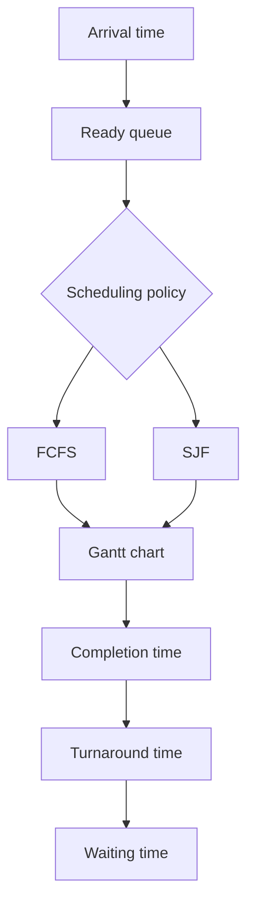

# Lab 8 — FCFS and SJF Scheduling

**Priority: 🔴 High**

## 🎯 Core Idea

CPU scheduling decides which ready process receives the CPU. **FCFS (First-Come, First-Served)** follows arrival order, while **SJF (Shortest Job First)** selects the shortest available CPU burst. Scheduling problems are solved by constructing a timeline and then calculating waiting and turnaround times.

## 🧠 Understand It

Important quantities:

- **Arrival Time (AT):** when the process becomes ready.
- **Burst Time (BT):** CPU time required.
- **Completion Time (CT):** when execution finishes.
- **Turnaround Time (TAT):**

$$
TAT = CT - AT
$$

- **Waiting Time (WT):**

$$
WT = TAT - BT
$$

Therefore:

$$
WT = CT - AT - BT
$$

### FCFS

Choose processes in arrival order.

```text
Arrival order → P1 → P2 → P3 → ...
```

FCFS is typically non-preemptive: once a process starts, it runs until its CPU burst completes.

### SJF

Among processes that are ready, select the one with the smallest burst time.

In the non-preemptive form:

```text
Choose shortest available job
        ↓
Run to completion
        ↓
Choose shortest among newly available jobs
```

## 💡 Worked Example

Assume:

| Process | AT | BT |
|---|---:|---:|
| P1 | 0 | 5 |
| P2 | 1 | 3 |
| P3 | 2 | 1 |

### FCFS

Timeline:

```text
0      5      8      9
|  P1  |  P2  | P3  |
```

Completion times:

```text
P1 = 5
P2 = 8
P3 = 9
```

Turnaround:

```text
P1: 5 - 0 = 5
P2: 8 - 1 = 7
P3: 9 - 2 = 7
```

Waiting:

```text
P1: 5 - 5 = 0
P2: 7 - 3 = 4
P3: 7 - 1 = 6
```

Average waiting time:

$$
\frac{0+4+6}{3} = \frac{10}{3}
$$

### Non-preemptive SJF

At time 0, only P1 is available, so P1 runs first. At time 5, P2 and P3 are available; P3 has the shorter burst.

```text
0      5   6      9
|  P1  |P3 |  P2  |
```

This illustrates why SJF can reduce waiting for short jobs.

## 🔗 Connections



## 📊 Comparison

| Property | FCFS | Non-preemptive SJF |
|---|---|---|
| Selection | Arrival order | Shortest available burst |
| Preemption | No | No |
| Key input | Arrival order | Burst times + arrivals |
| Potential issue | Long job can delay short jobs | Long jobs may wait |

## ⚠️ Common Confusions / Traps

- Do not schedule a process before its arrival time.
- In SJF, choose from **available** processes, not from processes that have not arrived.
- Waiting time is not the same as turnaround time.
- If the CPU is idle, advance time to the next arrival.
- A Gantt chart should be constructed before calculating CT/TAT/WT.

## 📝 What to Remember

### 🔴 Must Understand
- AT, BT, CT, TAT, WT.
- Gantt-chart method.
- FCFS vs SJF selection logic.

### 🟡 Must Remember
- Core formulas.
- Non-preemptive behavior.

### 🟢 Nice to Know
- More advanced scheduling variants.

## ✅ Quick Check

1. Why can FCFS make a short process wait behind a long process?
2. How do you decide which process SJF selects?
3. Why must arrival times be considered?
4. Derive waiting time from turnaround time.
5. What should you do if no process is ready?
