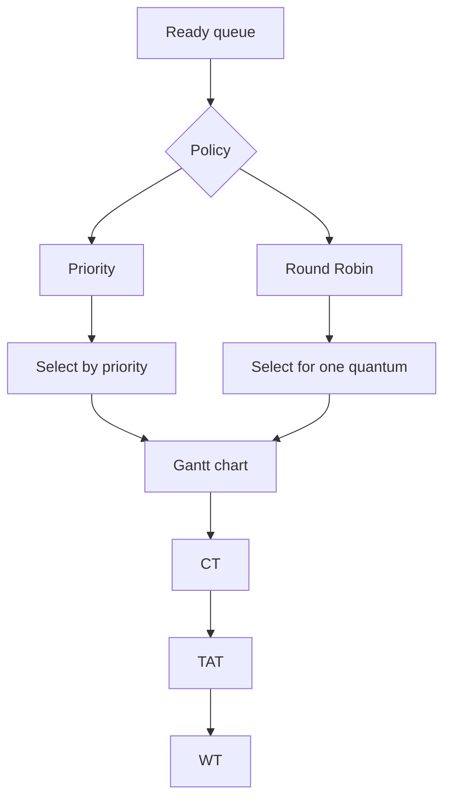

# Lab 9 — Priority and Round Robin Scheduling

**Priority: 🔴 High**

## 🎯 Core Idea

Priority scheduling chooses the ready process according to priority, while Round Robin gives each ready process a limited CPU time called a **time quantum**. These policies emphasize different goals: priority scheduling emphasizes the assigned priority relationship, while Round Robin emphasizes time sharing and responsiveness.

## 🧠 Understand It

### Priority Scheduling

A process is selected based on priority.

Important:

> The meaning of a smaller or larger numeric priority is a convention that must be specified by the problem. Do not assume it silently.

Priority scheduling may be:

- non-preemptive — a running process continues until completion;
- preemptive — a newly arrived higher-priority process can interrupt the running process.

### Round Robin

Round Robin uses a ready queue.

```text
P1 → P2 → P3 → P1 → P2 → ...
```

Each process receives at most one time quantum during a turn.

If:

$$
Quantum = q
$$

then a process that needs more than `q` CPU units is placed back into the ready queue with its remaining burst.

## 💡 Round Robin Example

Suppose:

| Process | AT | BT |
|---|---:|---:|
| P1 | 0 | 5 |
| P2 | 0 | 3 |
| P3 | 0 | 1 |

and:

```text
Time quantum = 2
```

A possible Gantt chart is:

```text
0   2   4   5   7   8
|P1 |P2 |P3 |P1 |P2 |
```

Remaining burst after each turn:

```text
P1: 5 → 3 → 1 → 0
P2: 3 → 1 → 0
P3: 1 → 0
```

The exact queue handling matters when processes arrive at different times.

## 📐 Scheduling Metrics

For each process:

$$
TAT = CT - AT
$$

$$
WT = TAT - BT
$$

Average waiting time:

$$
AWT = \frac{\sum WT_i}{n}
$$

Average turnaround time:

$$
ATAT = \frac{\sum TAT_i}{n}
$$

## 🔗 Connections



## 📊 Comparison

| Feature | Priority | Round Robin |
|---|---|---|
| Selection | Highest/lowest according to defined priority convention | Front of ready queue |
| Time slice | Not inherent to non-preemptive version | Fixed quantum |
| Main idea | Priority ordering | Fair time sharing |
| Key challenge | Starvation may occur | Quantum affects behavior |

## ⚠️ Common Confusions / Traps

- Always determine whether high or low numeric value means higher priority.
- Determine whether the question specifies preemptive or non-preemptive priority scheduling.
- In Round Robin, subtract the quantum only if the process actually receives that amount of CPU time.
- When a process finishes before the quantum, the CPU moves to the next ready process.
- Arrival times affect the ready-queue order.
- A very large quantum makes Round Robin approach FCFS behavior; this is a conceptual relationship, not a requirement for every implementation.

## 📝 What to Remember

### 🔴 Must Understand
- Priority selection.
- Preemptive vs non-preemptive priority scheduling.
- Round Robin queue rotation.
- Remaining burst time.
- Scheduling metrics.

### 🟡 Must Remember
- TAT and WT formulas.
- Time-quantum concept.

### 🟢 Nice to Know
- Advanced scheduling policies and implementation-specific tie-breaking rules.

## ✅ Quick Check

1. Why must the priority-number convention be stated?
2. What changes when priority scheduling becomes preemptive?
3. What happens to a process whose remaining burst exceeds the quantum?
4. Why does a large quantum make Round Robin resemble FCFS?
5. How do you calculate waiting time after constructing a Gantt chart?
